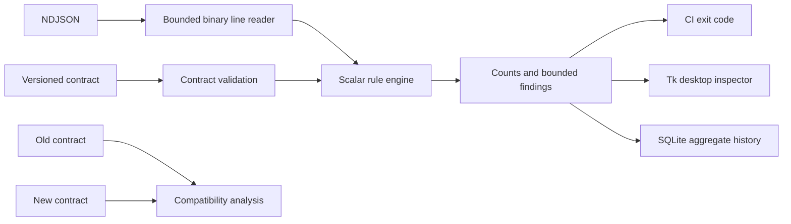

# Contract Sentinel

Catch breaking data-contract changes before they reach a pipeline. Validate NDJSON locally,
review failures in a Python desktop GUI, and use deterministic exit codes in CI.

Built for data engineers and backend maintainers who need explicit validation without shipping
customer records to a hosted service. Zero runtime third-party Python dependencies.

## What it does

- Streams NDJSON with bounded line size, record count and diagnostic samples.
- Validates required/nullable scalar fields, numeric ranges and unknown-field policy.
- Validates bounded nested objects and detects breaking changes inside their contracts.
- Detects compatibility changes: required additions, removed fields, narrowed types,
  tighter ranges, revoked nullability and newly constrained optional fields.
- Rejects duplicate JSON keys, non-finite numbers, malformed lines and incomplete scans.
- Fingerprints the bytes read and fails validation when source changes are detected during scanning.
- Stores only timestamps, contract hashes and aggregate counts in transactional SQLite history.
- Offers a Tk desktop inspector with a cancellable background worker and JSON report export.
- Exits 0 for pass, 1 for quality failure, 2 for invalid input/configuration.



## Quick start

Python 3.11+ is required. Tkinter is needed only for the GUI; on Ubuntu install `python3-tk`.
Create a virtual environment, activate it, then run from this directory:

```sh
python -m pip install .
contract-sentinel check examples/events.contract.json examples/good.ndjson
contract-sentinel check examples/events.contract.json examples/bad.ndjson
contract-sentinel check examples/events.contract.json examples/good.ndjson --history state/history.db
contract-sentinel diff examples/events.contract.json examples/events.contract.json
contract-sentinel check examples/nested.contract.json examples/nested-good.ndjson
contract-sentinel diff examples/nested.contract.json examples/nested-breaking.contract.json
contract-sentinel-gui
python -m unittest discover -s tests -v
```

The bad fixture and nested-breaking diff intentionally exit 1. In the GUI choose the example contract, then an example
dataset and click Validate. Export contains line numbers and rule codes, never raw records.
Click Cancel to stop a running scan; closing the window also signals cancellation. A cancelled
scan produces no report. Starting another scan clears the previous report to prevent stale exports.
Contracts and reports can contain business-sensitive field names; store them privately as needed.

## Contract format

See `examples/events.contract.json`. Top-level keys are exactly `version`, `fields`, `allow_extra`.
Supported scalar types: string, integer, number, boolean. Optional `required` and `nullable`
default to false. `min`/`max` apply only to numeric fields. Unknown constraints are rejected.
This is a small explicit dialect, not JSON Schema. Version is metadata; the tool does not
automatically reject contract downgrades. Integer-to-number is a compatible widening.
Compatibility means “would every old accepted record still be accepted?”

Object rules add `type: object`, nonempty `fields` and an explicit boolean `allow_extra`.
Up to eight nested object levels below the root are supported. See
[`docs/NESTED-OBJECTS.md`](docs/NESTED-OBJECTS.md) for examples and diagnostic paths.

## Bounds and error budgets

Default maximums: 100,000 records, 1 MB per line, 50 diagnostic samples. Core Python API exposes
all limits; CLI exposes `--max-records` and `--error-budget` (fraction 0..1). Empty datasets,
oversized lines and record-limit truncation always fail. Invalid records within the explicitly
configured fraction may pass. Record count, invalid-record count and violation count differ.
No raw input values or unknown key names appear in reports or stored history.
The core API accepts `should_cancel`, a zero-argument callable returning a boolean. Cancellation
raises `ScanCancelled` between bounded line reads and before returning a report. It does not
interrupt an operating-system read already in progress, including reads on slow/network filesystems.

## Engineering decisions and limitations

Python keeps the validator deployable without a service; SQLite provides atomic local history;
Tk avoids a browser/backend dependency for offline inspection. A bounded worker keeps the desktop
event loop responsive. CLI checks can run in any existing CI without credentials or network access.

No array schemas, regexes, semantic date validation, distributed
jobs, authentication, model integration, or automatic schema inference. A very large individual
contract is rejected at 1 MB. The GUI checks up to the default record cap.
Metadata checks detect common source changes during scanning; they do not provide immutable snapshots.
Exported reports distinguish complete fingerprints from bounded prefixes. See
[`docs/PROVENANCE.md`](docs/PROVENANCE.md) for lookahead, consistency and hash privacy limits.
No benchmark, coverage percentage, adoption or uniqueness claim is made.

No license grant has been selected by the owner. See `CONTRIBUTING.md` and `SECURITY.md`.
Roadmap: stronger immutable-snapshot inputs and additional
compatibility/property tests before expanding the dialect.
